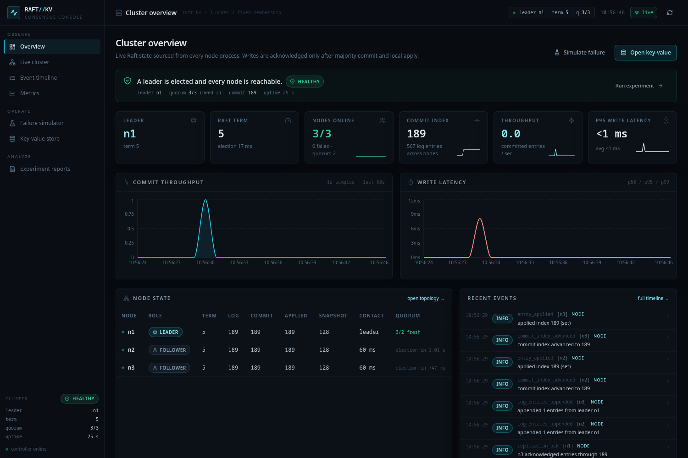

# RaftKV Failure Lab

A Raft-backed key-value store with independently running node processes, real process and
network fault injection, a React observability dashboard, Prometheus metrics, and automated
safety checks that run against live nodes.

This is not a UI mock-up of consensus. Every node is a separate OS process with its own
event loop, HTTP server, SQLite database, snapshot file and log file. Every inter-node Raft
RPC crosses a real TCP socket through a fault-injecting mesh proxy. A write is acknowledged
only after a majority has durably accepted it, the leader has advanced its commit index,
and the leader has applied it to its local state machine.



## What is implemented

- **Raft from scratch** — randomized elections, RequestVote up-to-date rules, heartbeats,
  per-peer bounded replication, majority commit with the current-term restriction, no-op
  entry on election, conflict-index backtracking, log truncation, snapshots and
  InstallSnapshot, restart recovery, check-quorum step-down, and fresh-quorum leader reads.
- **Real process isolation** — one uvicorn process per node, distinct ports, data directory
  and append-only log. Nodes are started, killed with `SIGKILL`, and restarted by a
  supervisor; no in-process fake cluster is used in integration tests.
- **Real fault injection** — arbitrary network partitions, per-link or global latency,
  per-link or global packet loss, one-click leader failure, and a seeded random-failure
  schedule with probability, interval, recovery delay, failure limit and duration.
- **Live observability** — REST + WebSocket cluster snapshots, per-node events, metrics
  history, Raft log inspection, and a Prometheus exposition endpoint.
- **Seven-page dashboard** — Overview, Cluster topology, Simulator, Key-value explorer,
  Timeline, Metrics and Reports. Destructive commands require confirmation.
- **Automated safety checks** — seven live checks covering Election Safety, Leader
  Append-Only, Log Matching, Leader Completeness, State Machine Safety, Commit Safety and
  client-ack safety.
- **Destructive integration tests** — real leader crashes, follower crashes, partitions,
  restarts, snapshot catch-up, five-node clusters, and checker execution during failover.
- **Reproducible experiments and benchmarks** — six scenarios run against live processes;
  every number in a report comes from that run and raw reports are retained.

## Quick start (local)

Prerequisites:

- Python 3.12+ (tested on 3.14.6)
- Node.js 22.12+ and npm (tested on 22.23.2)
- Linux or macOS. Node crash injection uses `os.killpg`; Windows is not supported.

```bash
python3 -m venv .venv
source .venv/bin/activate
pip install -r requirements.txt
(cd frontend && npm ci)
```

Run the backend (it supervises the three node processes):

```bash
make run
# equivalent: DATA_DIR=data .venv/bin/python -m backend.main
```

In a second terminal, run the dashboard:

```bash
make dev-frontend
# equivalent: cd frontend && npm run dev
```

Open:

| Service | URL |
| --- | --- |
| Dashboard (Vite) | http://127.0.0.1:5173 |
| Controller API / OpenAPI | http://127.0.0.1:8000/docs |
| Prometheus metrics | http://127.0.0.1:8000/metrics |
| Node n1 / n2 / n3 | http://127.0.0.1:7001 / 7002 / 7003 |
| Mesh proxies | http://127.0.0.1:7101 / 7102 / 7103 |

`make dev` starts both backend and frontend together. Data is written to `./data` by
default; reports are stored in `data/experiments/`.

## Docker

```bash
make docker-up
# or: docker compose up -d --build
```

| Service | URL |
| --- | --- |
| Dashboard (nginx) | http://127.0.0.1:8080 |
| Controller API | http://127.0.0.1:8000 |
| Prometheus UI | http://127.0.0.1:9090 |

The controller container runs the supervisor and three child node processes. They remain
separate processes with separate ports and storage, which is required for real `SIGKILL`
fault injection. Node and proxy ports are bound to loopback for diagnostics; clients use
the controller API. Data is persisted in the `raft-data` volume.

Stop with `make docker-down`. This keeps the data volume. Remove it explicitly with
`docker compose down -v` if you want a clean cluster.

## A five-minute demo

1. Open **Overview** and verify three online nodes, one leader and a quorum of 2.
2. Open **Key-value**, write a key, and read it back.
3. Open **Simulator**, choose **Kill leader**, and confirm. Watch a new term and leader
   appear. Writes fail briefly during election and then resume.
4. Restart the old leader and watch it catch up from the new leader.
5. Partition the network into `{current leader}` and the other two nodes. The isolated
   leader loses quorum, steps down, and cannot serve writes; the majority elects a new
   leader. Heal the partition and verify all state machines converge.
6. Add 200 ms latency or 25 % packet loss and observe the latency and retry behavior in
   **Metrics** and **Timeline**.
7. Open **Reports**, run `leader_crash` or the full benchmark suite, and inspect the live
   safety-check counts, assertions and event timeline.

## API examples

```bash
# Write through the controller; it discovers and forwards to the current leader.
curl -sS -X POST http://127.0.0.1:8000/api/kv \
  -H 'content-type: application/json' \
  -d '{"op":"set","key":"hello","value":"raft"}'

# Fresh-quorum leader read.
curl -sS http://127.0.0.1:8000/api/kv/hello

# Crash a specific node process (SIGKILL).
curl -sS -X POST http://127.0.0.1:8000/api/nodes/n2/crash

# Partition {n1} from {n2,n3}.
curl -sS -X POST http://127.0.0.1:8000/api/simulation/partition \
  -H 'content-type: application/json' \
  -d '{"groups":[["n1"],["n2","n3"]]}'

# Heal all partitions.
curl -sS -X POST http://127.0.0.1:8000/api/simulation/heal

# Run one scenario or the complete six-scenario benchmark.
.venv/bin/python scripts/benchmark.py --scenario leader_crash --duration 10 --rate 6
.venv/bin/python scripts/benchmark.py --duration 10 --rate 6 \
  --output /tmp/raftkv-benchmark.json
```

If no majority is reachable, writes return `503`/`504`; direct writes to a node that is not
the leader return `409`. The controller never fabricates an acknowledgment.

## Test results

Run everything:

```bash
make test          # backend + frontend
make typecheck
make build
```

Last verified on 2026-11-01:

```text
backend:  27 passed in 21.50s        # 8 unit + 8 live-process integration + 11 audit regressions
frontend: 16 passed in 0.68s         # 3 files, Vitest + Testing Library
typecheck: passed                    # tsc --noEmit
build:     passed                    # 852.80 kB JS, 36.35 kB CSS (gzip 238.41 / 7.31 kB)
npm audit: 0 vulnerabilities         # frontend production + development tree
pip audit: 0 known vulnerabilities   # pip-audit -r requirements.txt
```

The integration suite starts and kills real processes. It covers election and replication,
leader failover with rejoin, partition minority rejection and heal, restart persistence,
the consistency checker on a live cluster, the checker during leader failure, a five-node
cluster, snapshot catch-up, stale-read rejection, interrupted snapshot recovery, and
malformed-entry/CORS regressions. See [`docs/testing.md`](docs/testing.md) and the
[release audit](docs/audit.md) for findings, evidence, and residual risks.

## Real benchmark results

The following suite ran against this repository on a local three-node cluster. The raw
report and all six per-scenario reports are in [`docs/results/`](docs/results/).

- **Machine:** 12th Gen Intel Core i5-1240P, 16 logical CPUs, 15 GiB RAM, Fedora 44
  (kernel 7.1.3), Python 3.14.6
- **Configuration:** 10 s per scenario, 6 attempted operations/s, 3 client workers,
  approximately one read per six operations, 200 ms one-way latency, 25 % packet loss
- **Suite:** `benchmark-20261031T054524` — **passed**

| Scenario | Outcome | Committed writes/s | p50 ms | p95 ms | p99 ms | Failed writes | Recovery | Consistency |
| --- | --- | ---: | ---: | ---: | ---: | ---: | ---: | --- |
| normal | passed | 4.95 | 16.12 | 23.77 | 25.65 | 0 | — | passed |
| follower_down | passed | 5.10 | 16.24 | 21.07 | 21.57 | 0 | 0.83 s | passed |
| leader_crash | passed | 4.50 | 16.30 | 22.61 | 27.35 | 6 | 0.98 s | passed |
| latency | passed | 4.95 | 18.09 | 425.26 | 430.05 | 0 | — | passed |
| packet_loss | passed | 5.10 | 20.04 | 221.97 | 222.74 | 0 | — | passed |
| partition | passed | 4.66 | 15.87 | 21.52 | 22.08 | 3 | 0.27 s | passed |

These are honest single-host measurements of a Python implementation, not a saturated
throughput benchmark. The target rate is 6 attempted operations/s, of which roughly five
are writes. Leader-crash failures are writes attempted during the election window. The
latency scenario's p95 reflects two 200 ms one-way links plus commit and apply. See
[`docs/benchmarking.md`](docs/benchmarking.md) for method, caveats and reproduction steps.

## Architecture

```text
React dashboard ── REST/WS ── Controller (FastAPI, :8000)
                                  │ lifecycle + observation + client gateway
                                  │ never votes, never appends
                  ┌───────────────┼───────────────┐
                  ▼               ▼               ▼
                node n1         node n2         node n3       direct management
                :7001           :7002           :7003         traffic (status/logs)
                  ▲               ▲               ▲
                  │               │               │
              proxy 7101      proxy 7102      proxy 7103
                  └──── all inter-node Raft RPCs cross these proxies ────┘
                        partition · latency · packet loss
```

Each node has SQLite (`WAL`, `synchronous=FULL`) for term/vote, log, applied state machine
and bounded apply history, plus an atomically replaced JSON snapshot. See
[`docs/architecture.md`](docs/architecture.md) and
[`docs/raft_protocol.md`](docs/raft_protocol.md).

## Repository map

```text
backend/
  raft/          log, persistence, RPC models/client, node state machine, HTTP node app
  simulator/     controller, mesh proxy, process supervisor, consistency checker, experiments
  api/           public REST + WebSocket API
  monitoring/    Prometheus collector
  tests/         unit and live-process integration tests
frontend/src/
  pages/         Overview, Cluster, Simulator, KV, Timeline, Metrics, Reports
  components/    layout, dialogs, event list, charts, UI primitives
  hooks/         WebSocket-backed cluster context
  services/      typed API client
docs/            architecture, protocol, scenarios, testing, benchmarking, decisions
docker/          backend/frontend images, nginx config
prometheus/      scrape configuration
scripts/         benchmark and smoke-test clients
```

## Documentation

- [`docs/architecture.md`](docs/architecture.md) — topology, components, data flow, deployment
- [`docs/raft_protocol.md`](docs/raft_protocol.md) — exact protocol and persistence behaviour
- [`docs/failure_scenarios.md`](docs/failure_scenarios.md) — faults, expected outcomes, demo steps
- [`docs/testing.md`](docs/testing.md) — test inventory, what is proven, real results
- [`docs/benchmarking.md`](docs/benchmarking.md) — methodology, results, limitations
- [`docs/engineering_decisions.md`](docs/engineering_decisions.md) — trade-offs and rejected alternatives
- [`docs/audit.md`](docs/audit.md) — 2026-11-01 release audit, reproduced findings, evidence, residual risks

## Configuration

| Variable | Default | Meaning |
| --- | --- | --- |
| `DATA_DIR` | `data` | Controller data, node directories, reports |
| `CLUSTER_SIZE` | `3` | Odd cluster size >= 3 (3 or 5) |
| `NODE_BASE_PORT` | `7001` | First node HTTP port |
| `PROXY_BASE_PORT` | `7101` | First mesh proxy port |
| `AUTO_START` | `true` | Start the cluster when the controller starts |
| `ELECTION_TIMEOUT_MIN` / `MAX` | `0.8` / `1.5` | Randomized election timeout, seconds |
| `HEARTBEAT_INTERVAL` | `0.2` | Leader heartbeat interval, seconds |
| `RPC_TIMEOUT` | `1.5` | Inter-node RPC timeout, seconds |
| `SNAPSHOT_THRESHOLD` | `128` | Applied entries between snapshots |
| `CLIENT_TIMEOUT` | `6.0` | Leader commit timeout, seconds |
| `API_HOST` / `API_PORT` | `0.0.0.0` / `8000` | Controller bind address (container-internal; Compose publishes loopback only) |
| `CORS_ORIGINS` | empty | Comma-separated exact browser origins; empty disables CORS, wildcard `*` is rejected |
| `DASHBOARD_BIND` / `DASHBOARD_PORT` | `127.0.0.1` / `8080` | Host binding for the dashboard in Compose |
| `PROMETHEUS_BIND` / `PROMETHEUS_PORT` | `127.0.0.1` / `9090` | Host binding for Prometheus in Compose |

Compose passes only the controller variables explicitly listed in `docker-compose.yml`.
`CORS_ORIGINS` is read when the controller runs directly (the dashboard is same-origin
through nginx); add it to the Compose `environment` block if a separate origin needs access.

## Scope and limitations

This is a complete, tested implementation of the Raft protocol for a fixed membership,
plus a serious failure lab. It is not presented as a production operations product:

- Fixed cluster membership; no dynamic add/remove server.
- No client session deduplication. `SET`/`DELETE` are idempotent, so retries are safe.
- Snapshots are single JSON payloads, not chunked streams.
- No pre-vote. Check-quorum prevents a stale minority leader from serving reads, but this
  is not a full formal lease mechanism.
- The dashboard and API have no authentication and are intended for local or
  trusted-network use. Compose publishes them on loopback by default; do not expose them
  without an authenticated reverse proxy or SSH tunnel.
- KV keys and values are visible in the event timeline, `events.jsonl` and request paths.
  This is an observability lab, not a secrets store.
- The controller and dashboard containers still run as root. They use
  `no-new-privileges`, but a non-root conversion remains a production hardening item.
- Fault injection is process-level and network-level within one host; it does not simulate
  disk corruption, kernel panics or clock skew.
- Benchmarks are single-host and client-limited; see the caveats in the benchmarking doc.

## Development

```bash
make help
make test
make typecheck
make build
make smoke
make experiment SCENARIO=partition DURATION=10 RATE=6
make benchmark DURATION=10 RATE=6
make clean
```

`make smoke` requires a running controller. The benchmark and experiment targets also
require a running cluster and write real reports that appear in the Reports page.
